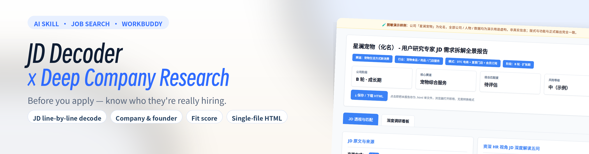
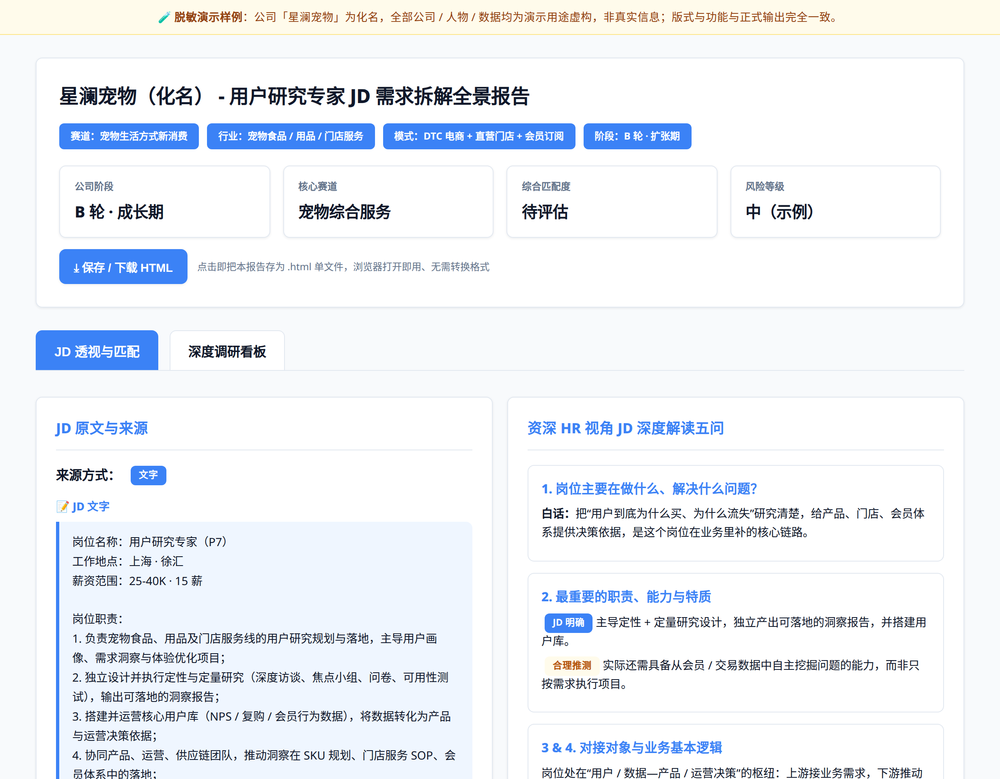
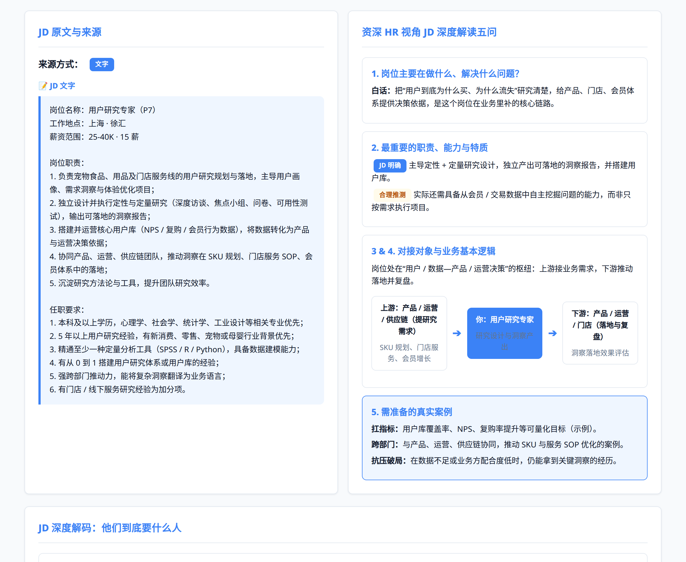
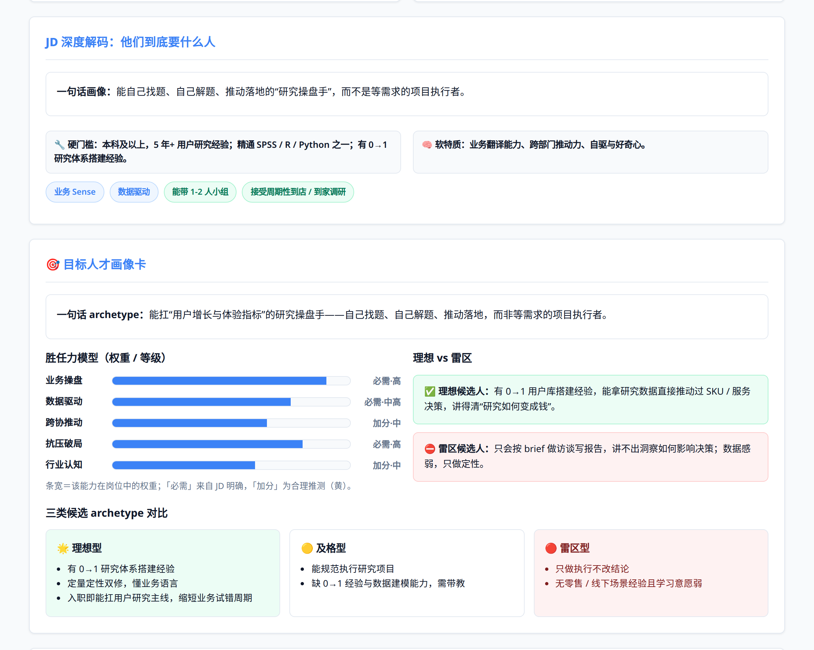
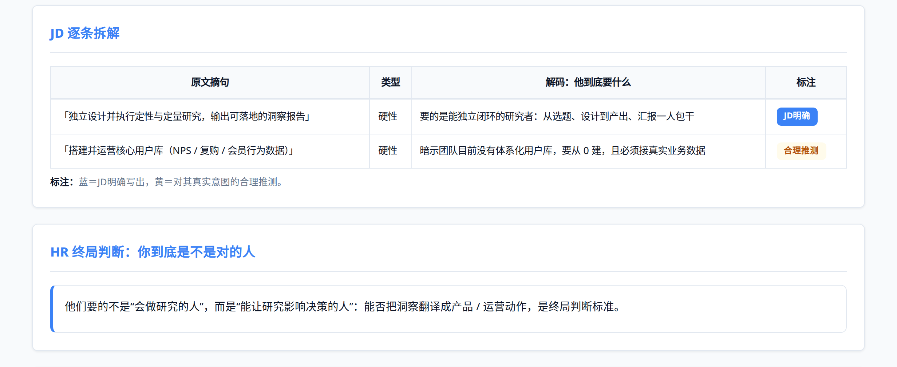
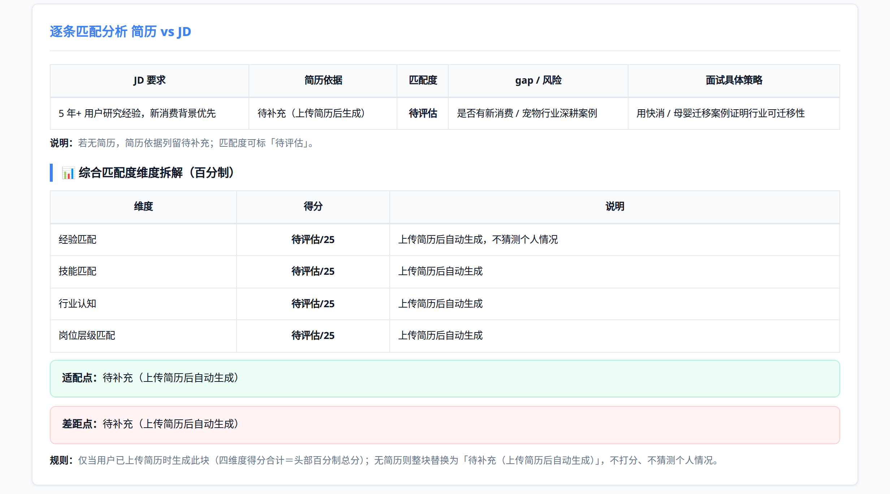
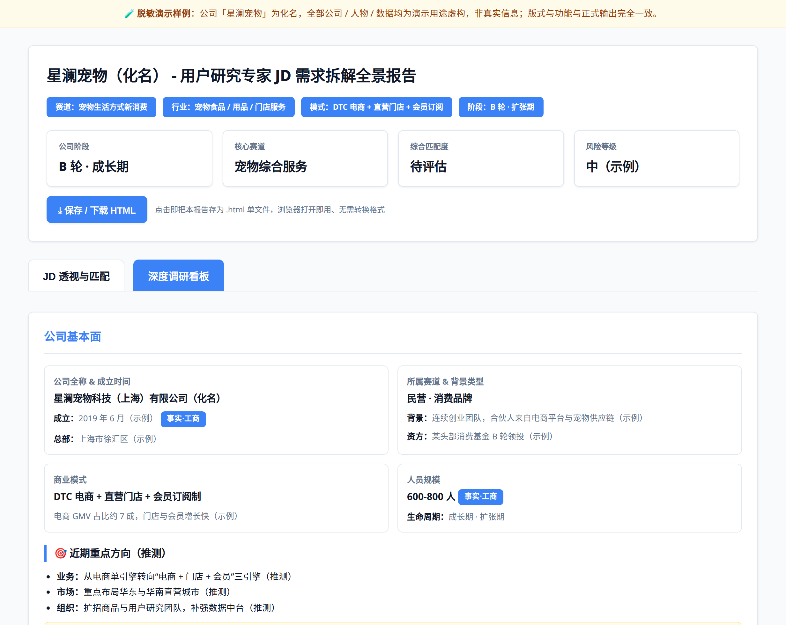

<div align="center">
  
</div>

<h1 align="center">job-company-insights</h1>

<p align="center"><b>One JD in. A full “role + company” report out.</b><br/>
Before you apply, see who they really want, what the role solves, and how far you are from it.</p>

<p align="center">
  English · <a href="README.md">中文</a>
  &nbsp;|&nbsp;
  
  
</p>

---

## Open it in one click

| What | One click |
|---|---|
| Homepage (EN / 中文 switch) | **[▶ Open homepage](https://htmlpreview.github.io/?https://github.com/ella-sun456/job-company-insights/blob/main/index.html)** |
| Full demo report (redacted sample) | **[▶ Open demo](https://htmlpreview.github.io/?https://github.com/ella-sun456/job-company-insights/blob/main/demo/report-demo.html)** |
| Skill guide (principles, modules, install) | **[▶ Open guide](https://htmlpreview.github.io/?https://github.com/ella-sun456/job-company-insights/blob/main/docs/skill-guide-en.html)** |

> GitHub does not render HTML — clicking a `.html` file shows raw source. That is platform behaviour. The links above go through an online renderer and open the formatted page directly; you can also download the files and open them locally.

## What it is

An AI skill for job seekers. Send the target JD (screenshot, link or plain text) plus a company name. It researches first, then returns a **single-file, two-tab HTML report**: the left tab decodes the role and your fit, the right tab covers the company from registration data through business model, competitors and unstated needs.

Not keyword parroting — recruiter view (five HR questions, intent decoding, target persona) and candidate view (fit score, gaps, interview strategy) live in the same document.

## What you get

| Module | The question you can answer |
|---|---|
| Five HR questions + persona card | What is this role really doing? Which type of person are they hiring? |
| JD line-by-line decode (blue = stated / yellow = inferred) | What sits behind each requirement? |
| 100-point fit + gap list (only with a résumé) | How far off on each of the four dimensions? What to fix within two weeks? |
| Company fundamentals, model, competitors | How does it make money? Main battlefield or side project? |
| Unstated needs + questions to ask back + interview intel | What gets tested? Which three questions should I ask? |

## What the report looks like (direct preview, no click needed)

Below are real screenshots of the generated report (demo company is a fictional alias, layout matches the real output exactly):

<div align="center">
  <p align="center"><b>① Header · four overview cards</b></p>
  
  <br/><br/>
  <p align="center"><b>② JD text + five HR questions</b></p>
  
  <br/><br/>
  <p align="center"><b>③ Target persona card</b></p>
  
  <br/><br/>
  <p align="center"><b>④ JD line-by-line decode (blue = stated / yellow = inferred)</b></p>
  
  <br/><br/>
  <p align="center"><b>⑤ 100-point fit · four-dimension breakdown</b></p>
  
  <br/><br/>
  <p align="center"><b>⑥ Company research dashboard (right tab)</b></p>
  
</div>

> These are static screenshots to show layout and modules. For the interactive experience (tab switch, image zoom, bottom-right download button), click the demo link in the "Open it in one click" table above.

## Three rules it never breaks

- **Anti-hallucination**: primary sources first; when something can't be verified it says "unconfirmed" instead of inventing numbers.
- **Colour-coded confidence**: stated in the JD = blue, reasonable inference = yellow, so you know what is safe to say out loud.
- **No score without a résumé**: with only a JD it decodes the role and asks whether to add a résumé.

## Install

1. **Desktop app**: download [install/job-company-insights.zip](install/job-company-insights.zip) and import it — no unzip needed.
2. **Coding agents**: copy `SKILL.md` + `references/` + `assets/` into `~/.codebuddy/skills/`, `~/.claude/skills/` etc., or use [install/job-company-insights.skill](install/job-company-insights.skill).
3. **Chat AIs**: paste `install/智能体系统提示词.txt` into the system prompt and upload the template file to the knowledge base.

Platform entry points and troubleshooting: [docs/install.md](docs/install.md).

**Updating**: the skill is a local copy and never self-updates. Grab the latest zip from [Releases](https://github.com/ella-sun456/job-company-insights/releases/latest) and import it again to overwrite; `git clone` users can simply `git pull`. The version is printed at the top of `SKILL.md`.

## Usage

```
Use job-company-insights to analyze this JD: [paste JD text / screenshot / link], company: Acme Tech
```

Add your résumé for the 100-point fit score; a JD alone also works — it decodes the role first and then asks. The output opens in any browser and can be saved from the bottom-right button.

## Notes

1. Company information relies on publicly verifiable sources; anything unverifiable is marked "inferred" or "unconfirmed".
2. Analysis is for job-search reference only, not the sole basis for an application decision.
3. Reports are single files and readable offline once downloaded.
4. In the demo, "Starlan Pets" is a pseudonym and all figures are fictional; the layout matches real output.
5. If the layout degrades, tell it: output the full HTML exactly as the template, do not simplify.

## Credits & versioning

This project grew out of studying publicly shared AI-skill patterns, job-analysis methods and company-research case studies. Some early references can no longer be traced to their authors or links; they will be added as they are verified — open an issue and it will be credited immediately.

Release history: [CHANGELOG.md](CHANGELOG.md). Current version **v1.2.0**.
