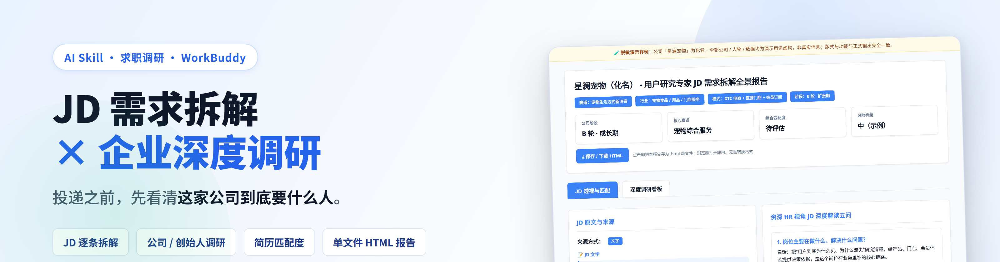
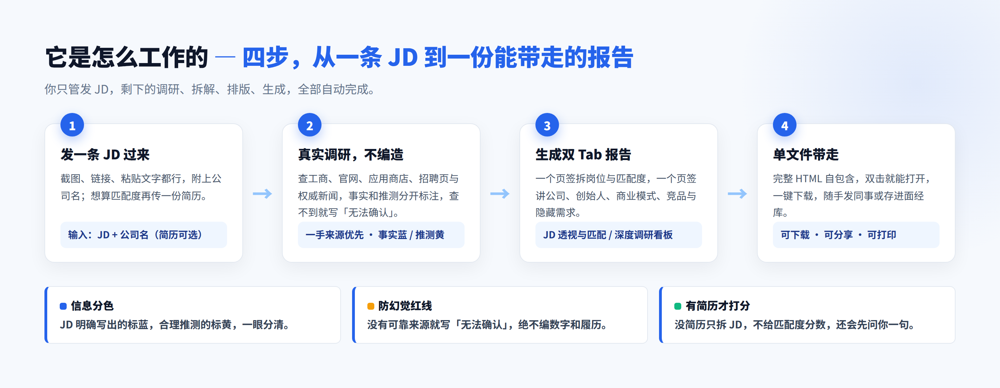
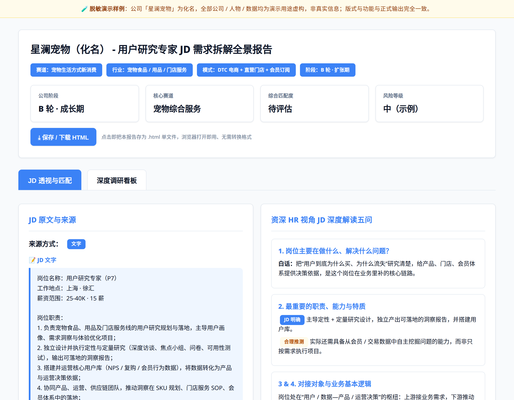
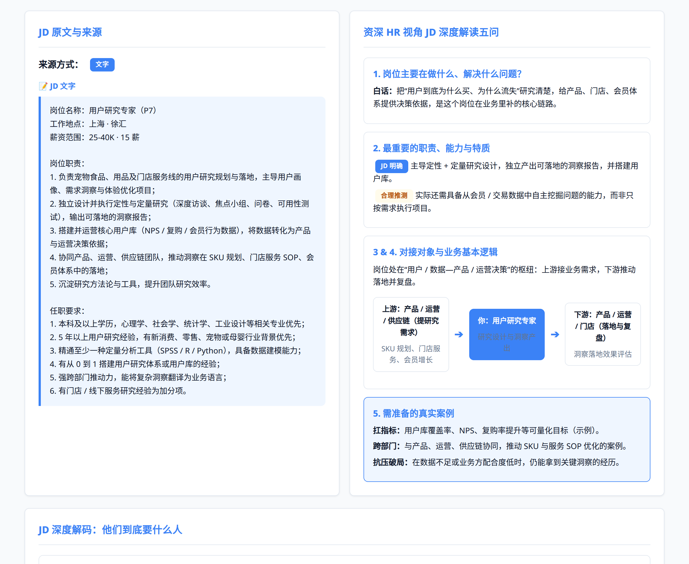
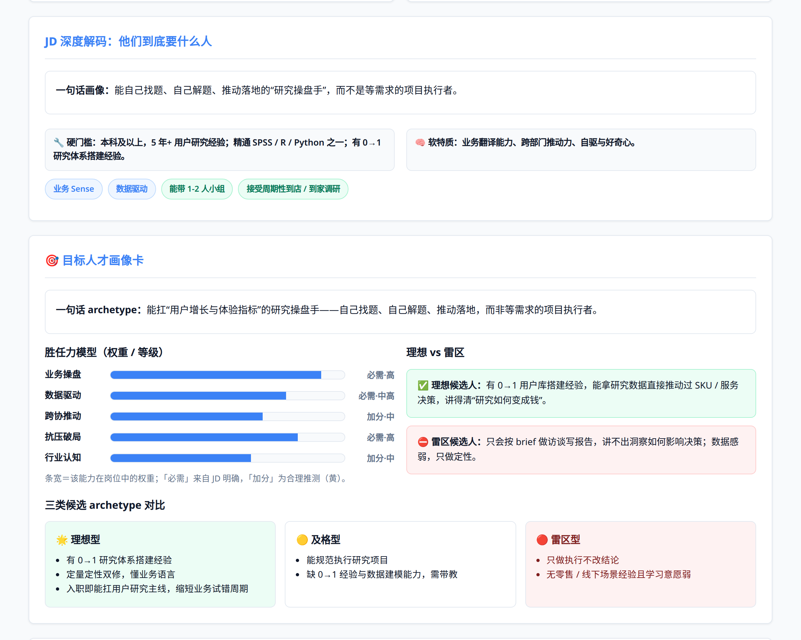
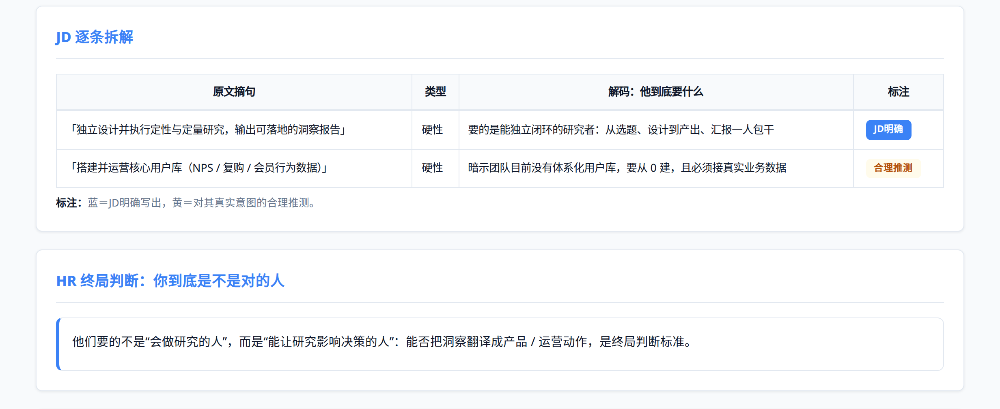
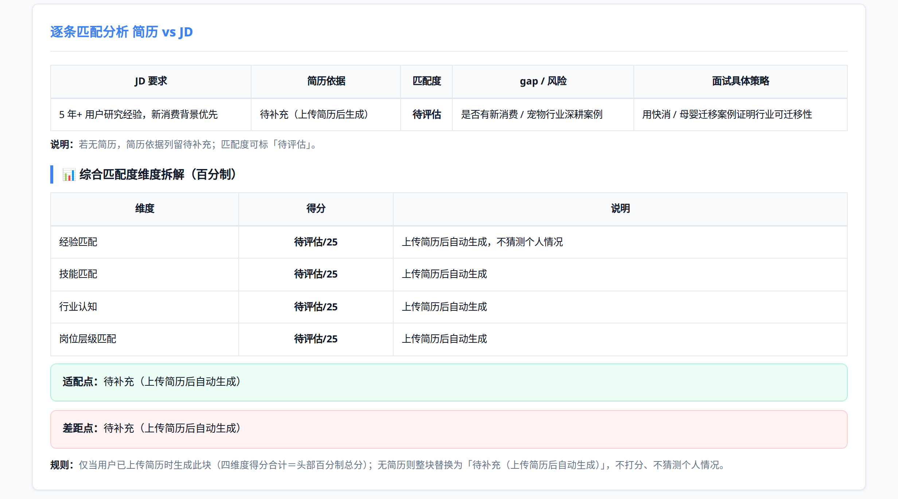
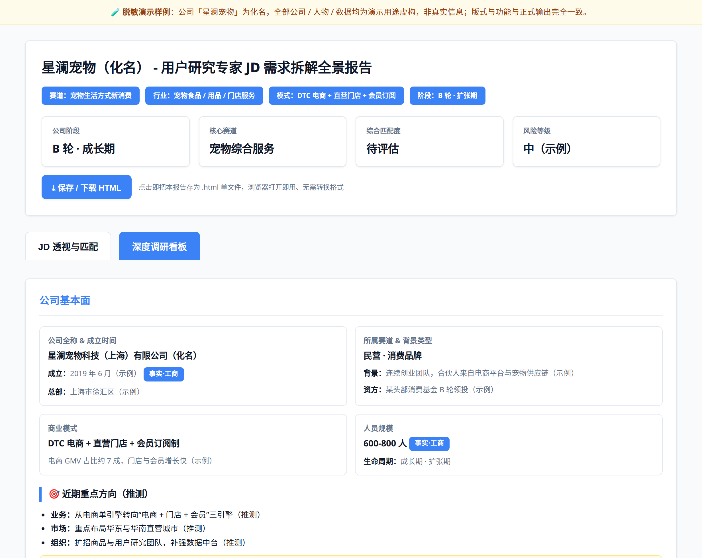

<div align="center">
  
</div>

<h1 align="center">jd-company-insights</h1>

<p align="center">
  <b>一条 JD 进去，一份「岗位 + 公司」全景报告出来。</b><br/>
  投递之前，先看清这家公司到底要什么人、这个岗位在解决什么问题、你和它还差多远。
</p>

<p align="center">
  
  
  
</p>

---

## 先看一眼

> GitHub 网页默认**不会渲染 HTML**（直接点 `.html` 只能看到源码，这是平台行为，不是文件坏了）。想“点开就看”，用下面第一种方式。

**① 在线直接看（推荐，无需下载）**
[▶ 打开完整 Demo 报告](https://htmlpreview.github.io/?https://github.com/ella-sun456/job-company-insights/blob/main/demo/report-demo.html)

**② 下载后双击打开**（浏览器直接渲染，离线也能看）

| 看什么 | 下载链接 |
|---|---|
| 项目主页（图文介绍） | [index.html](https://github.com/ella-sun456/job-company-insights/raw/main/index.html) |
| 完整 Demo 报告 | [demo/report-demo.html](https://github.com/ella-sun456/job-company-insights/raw/main/demo/report-demo.html) |
| 技能说明（原理与模块） | [docs/skill-guide.html](https://github.com/ella-sun456/job-company-insights/raw/main/docs/skill-guide.html) |

**③ GitHub Pages（开一次，永久在线）**
在仓库页面点 **Settings → Pages**，`Source` 选 **Deploy from a branch**，分支选 **main**、目录选 **/ (root)**，点 **Save**。等 30 秒左右，下面三个地址就能直接打开（含图片，不用下载）：

- `https://ella-sun456.github.io/job-company-insights/`（项目主页）
- `https://ella-sun456.github.io/job-company-insights/demo/report-demo.html`（Demo 报告）
- `https://ella-sun456.github.io/job-company-insights/docs/skill-guide.html`（技能说明）

> 仓库本身不用改造：`index.html` 在根目录、所有路径都是相对路径，开启后即可访问。

## 这是什么

一个面向**求职者**的 AI 技能：你把目标岗位的 JD 发过来（截图 / 链接 / 文字都行），再给个公司名，它会先做真实调研，再输出一份**单文件、双 Tab 的 HTML 全景报告**——左边拆岗位与你的匹配度，右边把这家公司从工商信息一直讲到商业模式、竞品和隐藏需求。

不是那种「JD 关键词复述一遍」的模板问答，而是把招聘方视角（HR 五问、真实意图解码、目标人才画像）和候选人视角（匹配度、差距、面试打法）放进同一份报告里。

<div align="center"></div>

## 你会得到什么

| 报告模块 | 你终于能回答的问题 |
|---|---|
| **资深 HR 视角五问** | 这个岗位到底在干什么？在业务里补哪条链路？要准备什么案例？ |
| **JD 逐条解码 + 目标人才画像卡** | 每一句要求背后的真实意图是什么？他们真正想招的是「哪种人」？ |
| **逐条匹配度 + 百分制评分** | 我哪几条够格、哪几条差一点？四个维度（经验 / 技能 / 行业认知 / 层级）各差多少？ |
| **定制自我介绍 + Gap 清单** | 面试第一段话怎么说？哪些坑必须在这两周补上？ |
| **公司基本面 + 创始人画像** | 这家公司有多大、处在什么阶段、老板是什么路数？ |
| **商业模式 + 产品与业务线 + 竞品** | 它靠什么赚钱？这个岗位所在业务线是主战场还是边缘业务？ |
| **隐藏需求与岗位差异** | JD 没写但八成在乎的是什么？面试时可以反问哪三个问题？ |
| **面经总结与行动指南** | 会考什么、面试前 1 天做什么、当天带什么？ |

**产出的报告长这样**（真实渲染截图）：

<div align="center"></div>

<p align="center">
  
  
</p>

<p align="center">
  
  
</p>

<p align="center">
  
</p>

完整效果可以直接打开 **[demo/report-demo.html](demo/report-demo.html)** 看——已脱敏的虚构样例（「星澜宠物」× 用户研究专家岗），双 Tab、下载按钮、各模块都是真的能点的那种。

## 报告里有哪些东西

**Tab 1 · JD 透视与匹配**
- JD 原文与来源（截图 / 链接 / 文字，按你实际给的方式呈现，截图可点击放大）
- 资深 HR 视角五问 + 上下游协作图
- JD 深度解码：一句话画像、硬门槛、软特质、隐藏期待
- 目标人才画像卡：胜任力权重条、理想 / 及格 / 雷区三类候选人对比
- JD 逐条拆解表：原文摘句 → 他到底要什么（蓝＝JD 明确，黄＝合理推测）
- 逐条匹配分析 + 四维度百分制拆解（适配点 / 差距点）
- 定制版自我介绍（≤250 字）、Gap 清单（红黄绿 + checkbox）
- 面经真题预测、面试前准备清单、面试中原则、当天准备

**Tab 2 · 深度调研看板**
- 公司基本面（全称 / 成立 / 总部 / 赛道 / 模式 / 规模，工商项标「事实」）
- 创始人画像（时间线：背景旅程 → 关键转折 → 低谷与逆袭 → 经营哲学）
- 商业模式 + 大客户依赖风险
- 产品与业务线矩阵（核心 / 主力 / 利润 / 引流）+ 主推产品
- 竞品矩阵（直接 / 间接 / 潜在威胁）
- 隐藏需求与岗位差异 + 面试可反问问题
- 结论建议：三句话总结、三个机会、三个风险、面试展示重点

## 几条不会破的底线

- **防幻觉**：优先一手来源（工商 / 官网 / 应用商店 / 招聘页 / 权威新闻），查不到就写「无法确认」，不编数字、不编履历。
- **信息分色**：JD 明确写出的标蓝，合理推测标黄；公司调研区分「事实·工商」与「推测」，一眼看得出来哪些能直接说、哪些要留个心眼。
- **有简历才打分**：只给 JD 就只拆岗位，不硬凑匹配度；系统会先用大白话问你一句「要不要补份简历」，不替你猜。

## 安装

**方式一 · WorkBuddy 桌面端一键导入（推荐）**
下载 [install/job-company-insights.zip](install/job-company-insights.zip)，直接导入、无需解压（`SKILL.md` 在压缩包根目录，导入器可直接识别）。

**方式二 · 编程型 Agent**
把根目录的 `SKILL.md` + `references/` + `assets/` 整体放进对应技能目录，例如 `~/.codebuddy/skills/`、`~/.claude/skills/`、`~/.trae/skills/`、`~/.cursor/skills/`、项目内的 `.github/skills/`。也可以直接用 [install/job-company-insights.skill](install/job-company-insights.skill)。

**方式三 · 聊天型 AI（豆包 / Kimi / MiniMax / 通义 / ChatGPT）**
新建智能体 → 把 [install/智能体系统提示词.txt](install/智能体系统提示词.txt) 贴进系统提示词 → 上传 [install/JD需求拆解-HTML模板-知识库上传版.txt](install/JD需求拆解-HTML模板-知识库上传版.txt) 到知识库。

各平台入口、目录对照、版式一致性排查，见 **[docs/install.md](docs/install.md)**。

## 怎么用

装好后直接说话就行，三种说法都触发：

```
用 job-company-insights 分析这个 JD：[粘贴 JD 文字 / 截图 / 链接]，公司：某某科技
```

- 想算匹配度，就把简历一起发上来（会自动跑百分制评分）；
- 只发 JD 也可以，会先拆岗位、再问你补不补简历；
- 生成的是完整 HTML，浏览器打开即看，页面上有「⤓ 保存 / 下载 HTML」按钮，随时导出单文件。

## 仓库结构

```
jd-company-insights/
├── index.html                    # 项目主页：一图看懂是什么、给什么
├── SKILL.md                      # 技能入口：角色、红线、工作流、初始化话术
├── CHANGELOG.md                  # 版本迭代记录
├── references/
│   └── html-spec.md              # 版式规范 + 逐模块数据 schema
├── assets/
│   ├── template.html             # 可直接跑的单文件 HTML 骨架
│   └── images/                   # 封面、流程图、6 张真机截图
├── demo/
│   ├── report-demo.html          # 脱敏示例报告，可直接打开看效果
│   └── README.md                 # Demo 说明 + 截图（GitHub 上能直接看）
├── docs/
│   ├── skill-guide.html          # 技能说明网页版（带截图，可点开看）
│   ├── skill-guide.md            # 技能说明完整版（含内联模板）
│   └── install.md                # 跨平台安装指南
└── install/
    ├── job-company-insights.zip  # 桌面端一键导入包
    ├── job-company-insights.skill
    ├── 智能体系统提示词.txt        # 聊天型 AI 用
    └── JD需求拆解-HTML模板-知识库上传版.txt
```

## 使用说明

1. 企业信息优先采用**公开可验证资料**（工商 / 官网 / 应用商店 / 招聘页 / 权威新闻），无法确认的内容标记为「推测」或「待验证」，不编造信息；离线环境下会如实写「无法确认」。
2. 所有分析结果**仅供求职参考**，不作为投递的唯一决策依据；面试前建议再自行核实关键数字。
3. HTML 报告全部为**单文件**，下载后无需联网，浏览器直接打开即可阅读。
4. `demo/` 里的报告是**脱敏示例**：公司「星澜宠物」为化名，人物、数据均为演示虚构，版式与真实输出完全一致。
5. 遇到版式走样，跟它说一句「按知识库里的模板原样输出完整 HTML，不要简化」即可纠正。

## 参考来源与致谢

本项目在学习公开分享的 AI Skill 写法、岗位分析方法与企业调研案例的基础上，经过个人整理、归纳与实践逐步形成。部分早期参考内容暂时无法确认原作者与原始链接，后续核实后会持续补充来源与致谢。

如果你发现其中某段内容来自你的分享而未被注明，欢迎提 Issue，我会立刻补上。

## 版本迭代

项目会持续完善岗位拆解、企业深度调研、图文报告与人岗匹配能力，具体更新记录见 [CHANGELOG.md](CHANGELOG.md)。

当前版本：**v1.1.0**
