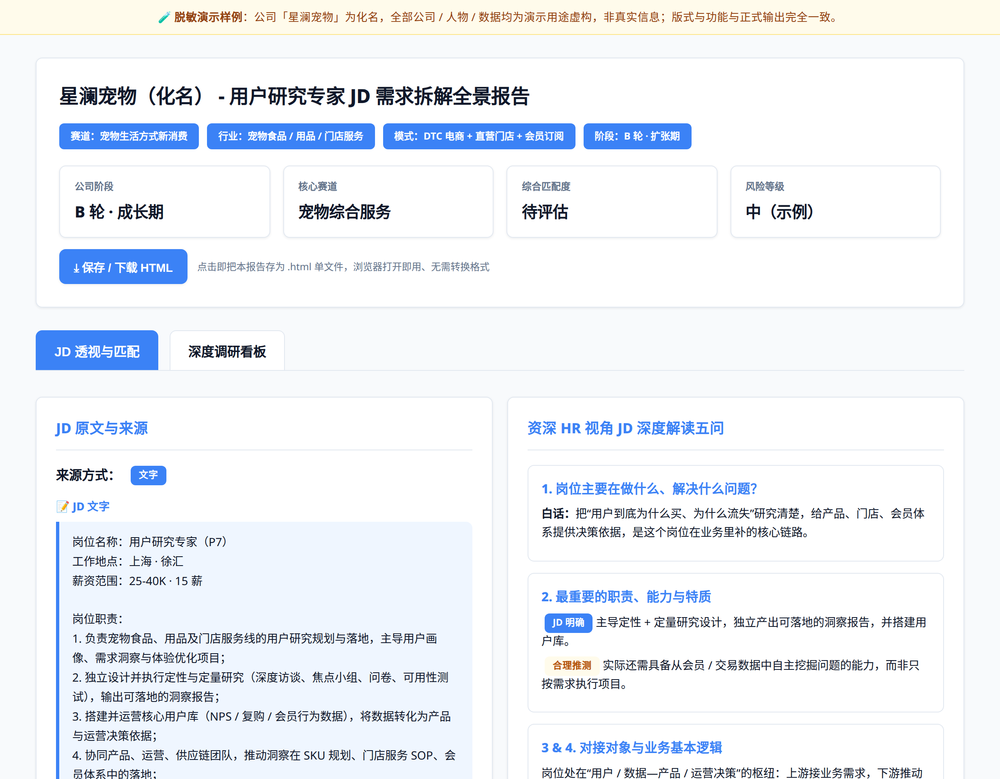
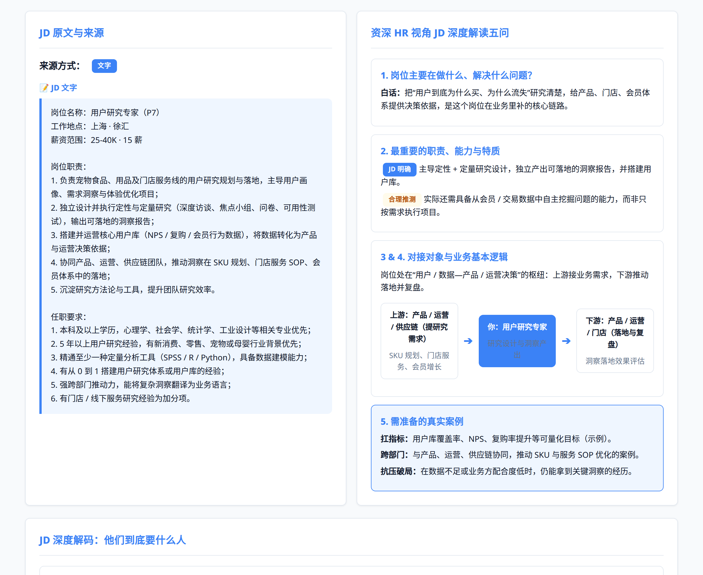
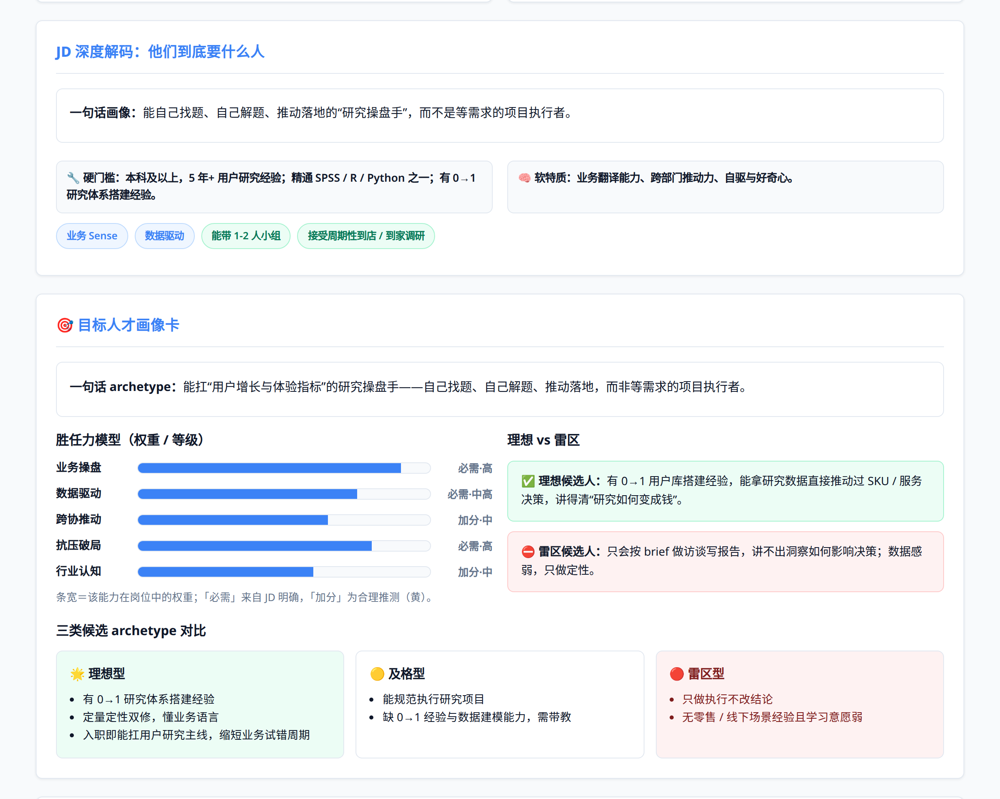
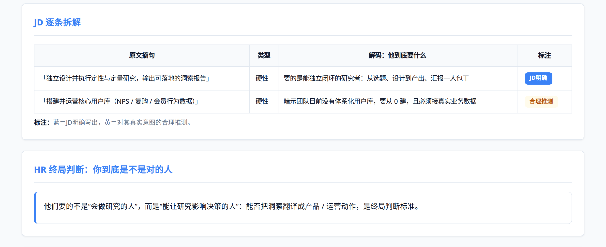
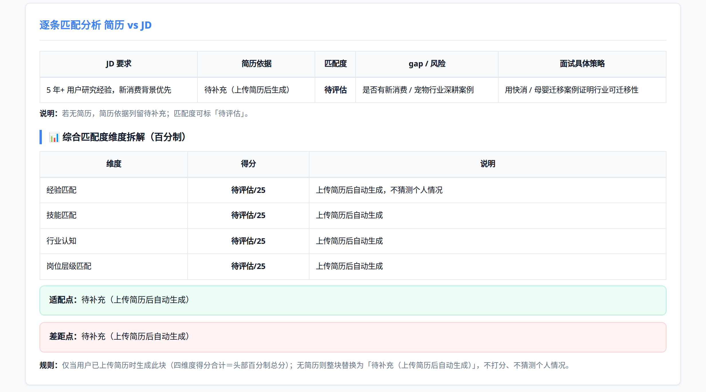
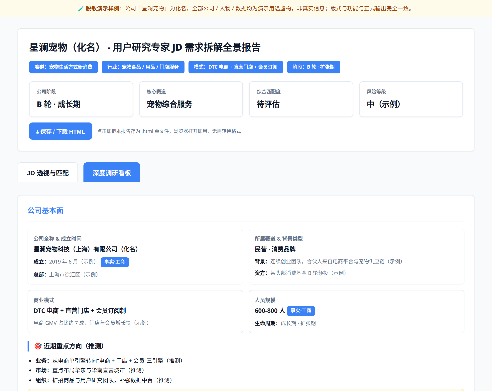

# Demo · 报告长什么样

一份**脱敏示例报告**：公司「星澜宠物」为化名，人物与数据均为演示虚构，但版式、双 Tab 切换、下载按钮与真实输出完全一致。

## 怎么打开

**在线直接看**：[▶ 打开 Demo 报告](https://htmlpreview.github.io/?https://github.com/ella-sun456/job-company-insights/blob/main/demo/report-demo.html)

**下载后双击**：[下载 report-demo.html](https://github.com/ella-sun456/job-company-insights/raw/main/demo/report-demo.html)，浏览器打开即看；页面右下角有「📥 下载 HTML 报告」按钮。

> GitHub 网页不会渲染 `.html`（点开只有源码），这是平台行为，用上面两种方式即可。

## 里面有什么

| Tab | 内容 |
|---|---|
| **Tab 1 · JD 透视与匹配** | JD 原文与来源、资深 HR 视角五问、JD 深度解码、目标人才画像卡、逐条拆解表、逐条匹配分析 + 四维度百分制、定制自我介绍、Gap 清单、面经与行动指南 |
| **Tab 2 · 深度调研看板** | 公司基本面（工商项标「事实」）、创始人画像时间线、商业模式、产品与业务线矩阵、竞品矩阵、隐藏需求与反问问题、结论建议 |

## 效果截图

| | |
|---|---|
|  |  |
|  |  |
|  |  |

回到 [项目主页](../README.md)。
